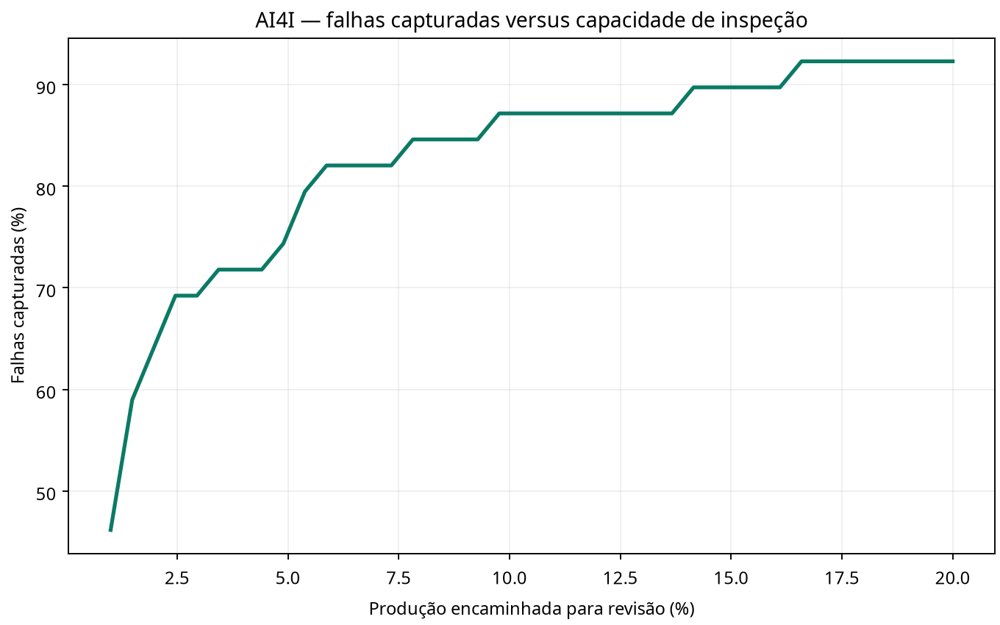

# 06 — Priorização de falhas para manutenção industrial

## Problema B2B

Um fabricante ou prestador de manutenção precisa decidir quais ativos inspecionar primeiro quando a equipe e a janela de parada são limitadas. O projeto transforma a classificação em uma pergunta operacional: qual proporção dos casos de falha conhecidos aparece no topo do ranking, e como esse trade-off varia com a capacidade de inspeção?

## Dados e limite de interpretação

Usa o UCI AI4I 2020, com 10.000 observações sintéticas criadas para refletir aspectos de manutenção preditiva industrial. Os atributos incluem temperatura do ar/processo, rotação, torque, desgaste da ferramenta e tipo do produto. A base também oferece rótulos de modos de falha. O script prevê `Machine failure` e exclui `TWF`, `HDF`, `PWF`, `OSF` e `RNF`, pois esses modos compõem diretamente o rótulo principal e causariam vazamento de informação. O dataset é sintético: não prova desempenho em uma fábrica real nem economia de manutenção.

## Método e rigor em Python

O pipeline tem funções separadas para carregamento, validação, pré-processamento, avaliação e visualização. A ordem original dos registros é usada para dividir treino, validação e teste (60/20/20) sem embaralhar, mas não entra como variável do modelo. Compara regressão logística balanceada e Random Forest com ponderação de classes. A escolha é feita pela Average Precision na validação; o teste é usado uma vez após a seleção. O pré-processamento numérico/categórico fica dentro de `Pipeline`/`ColumnTransformer`, evitando ajustar transformações usando o teste.

Métricas incluem Average Precision, ROC-AUC secundária, Brier score e precisão/recall nos 1%, 5% e 10% de maiores scores. São métricas de ordenação e classificação retrospectiva, não uma política de manutenção ou avaliação econômica.

## Resultado no split executado

No teste cronológico de 2.000 observações, com 39 falhas, o Random Forest balanceado selecionado na validação obteve Average Precision de **0,685**. Nos 1% com maior score, 18 das 39 falhas apareceram entre 20 alertas (precisão de 90% e recall de 46,2%). Ao encaminhar 5% para revisão, o modelo capturou 29 falhas (recall de 74,4%). São resultados de uma partição do benchmark sintético; não medem falhas evitadas ou desempenho numa fábrica.



## Executar

Requer Python 3.10 ou superior e acesso à internet na primeira execução:

```bash
python -m venv .venv
source .venv/bin/activate       # Windows: .venv\\Scripts\\activate
pip install -r requirements.txt
python failure_pipeline.py --output-dir artifacts
python -m unittest -v test_failure_pipeline.py
```

O cliente `ucimlrepo` busca o conjunto diretamente do UCI. O script produz `metrics.json`, `precision_recall_test.png`, `capture_vs_capacity.png` e salva localmente `failure_model.joblib`. O arquivo do modelo e dados locais são excluídos do Git por `.gitignore`; métricas e gráficos reproduzíveis estão versionados.

## Extensões para produção

Para avançar além do benchmark, seriam necessários dados históricos autorizados por ativo, alarmes e manutenção, timestamps de falhas/ações, horizonte acionável, lead time de peças, custos de parada e falsos alarmes. A validação precisaria respeitar grupos por ativo e períodos futuros, além de testar deriva e definir revisão de especialistas. Sem esses dados, não se estima downtime evitado nem ROI.

## Fonte

- UCI, [AI4I 2020 Predictive Maintenance Dataset](https://archive.ics.uci.edu/dataset/601/ai4i+2020+predictive+maintenance+dataset). O repositório informa a natureza sintética, 10.000 instâncias e licença CC BY 4.0.
