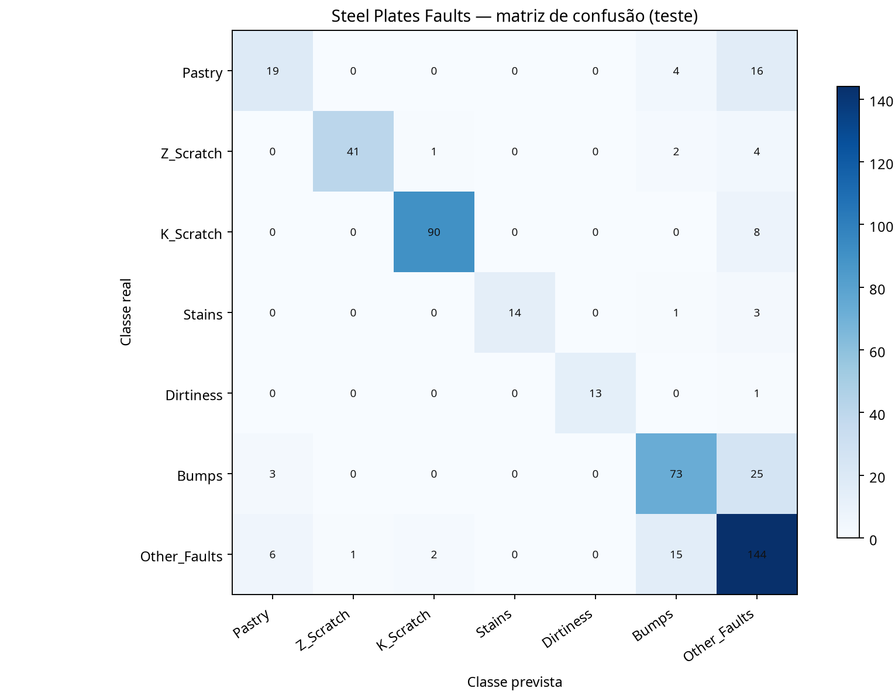
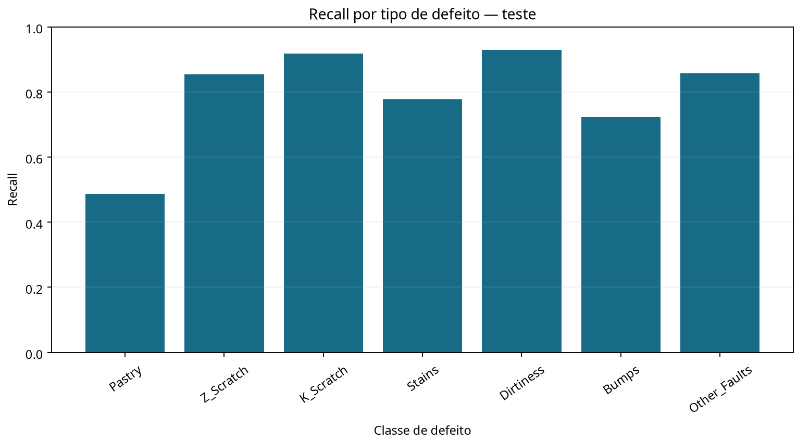

# 07 — Classificação de defeitos para qualidade em manufatura B2B

## Problema B2B

Uma siderúrgica ou fabricante que fornece material a outras empresas precisa identificar tipos de defeito para priorizar inspeção, retrabalho e análise de causa. O projeto avalia classificação de sete tipos de falha a partir de medidas geométricas e de intensidade associadas às placas. A previsão é apoio à inspeção, nunca autorização automática para rejeitar ou liberar produto.

## Dataset e semântica do alvo

Usa o UCI Steel Plates Faults: 1.941 registros, 27 atributos e sete colunas binárias de defeito. A página do UCI descreve sete tipos: Pastry, Z_Scratch, K_Scratch, Stains, Dirtiness, Bumps e Other_Faults. O pipeline valida que há exatamente um rótulo ativo em cada linha antes de convertê-los a uma classe multiclasse. Essa verificação evita impor a formulação errada caso uma versão da base apresente coocorrência.

## Avaliação

Mantém um teste estratificado de 25% intocado. Nos 75% de desenvolvimento, compara regressão logística balanceada e Random Forest com busca de hiperparâmetros por validação cruzada estratificada de cinco folds, usando F1 macro para que classes menores tenham peso explícito. Reporta também acurácia balanceada, macro/weighted F1, Average Precision one-vs-rest, top-2 accuracy, matriz de confusão e métricas por classe. Um baseline Dummy mostra o que se obtém prevendo sempre a classe majoritária.

Como a classe Dirtiness é rara e o dataset é pequeno, métricas por classe podem variar bastante conforme a amostra de teste. O resultado do split é ilustrativo; deve ser acompanhado por intervalos de incerteza e validação temporal/grupo em dados de fábrica antes de qualquer uso real.

## Resultado no split executado

No teste estratificado de 486 linhas, o Random Forest selecionado por validação cruzada obteve **F1 macro de 0,826**, **acurácia balanceada de 0,792**, **Average Precision macro one-vs-rest de 0,866** e **top-2 accuracy de 0,940**. O teste contém apenas 14 exemplos da classe Dirtiness; métricas dessa classe são particularmente incertas. Esses valores representam um split reprodutível do benchmark público, não uma estimativa de desempenho em produção.





## Executar

Requer Python 3.10 ou superior e internet na primeira execução:

```bash
python -m venv .venv
source .venv/bin/activate       # Windows: .venv\\Scripts\\activate
pip install -r requirements.txt
python quality_pipeline.py --output-dir artifacts
python -m unittest -v test_quality_pipeline.py
```

O script obtém o dataset via `ucimlrepo` e produz `metrics.json`, `confusion_matrix_test.png` e `recall_by_fault_test.png`. O modelo treinado é salvo localmente como `steel_fault_model.joblib` e excluído do Git por `.gitignore`.

## Extensões para uma operação industrial

Uma aplicação B2B precisaria de dados autorizados por lote/linha, confirmação independente do rótulo, custo de defeito, custo de inspeção e resultados de retrabalho. O split deveria refletir mudança temporal, lote ou planta; a regra de encaminhamento precisaria permitir revisão humana e medir os efeitos em falsos alarmes e defeitos escapados.

## Fonte

- UCI, [Steel Plates Faults](https://archive.ics.uci.edu/dataset/198/steel+plates+faults). O repositório informa 1.941 instâncias, 27 features, sete tipos de falha e licença CC BY 4.0.
- OpenML, [steel-plates-fault, dataset 1504](https://www.openml.org/d/1504), documentação complementar da codificação dos atributos e rótulos.
