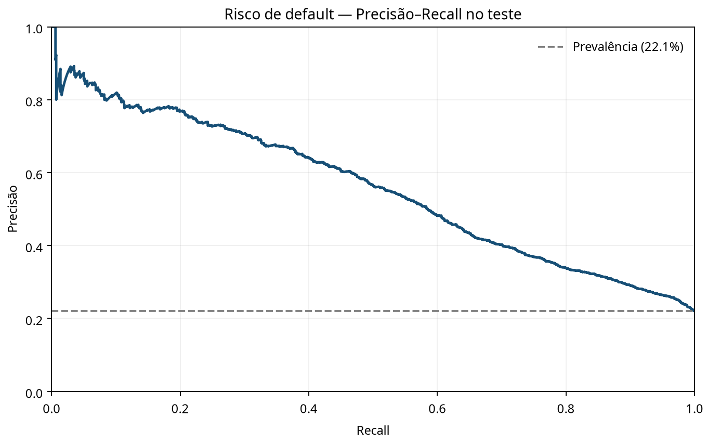
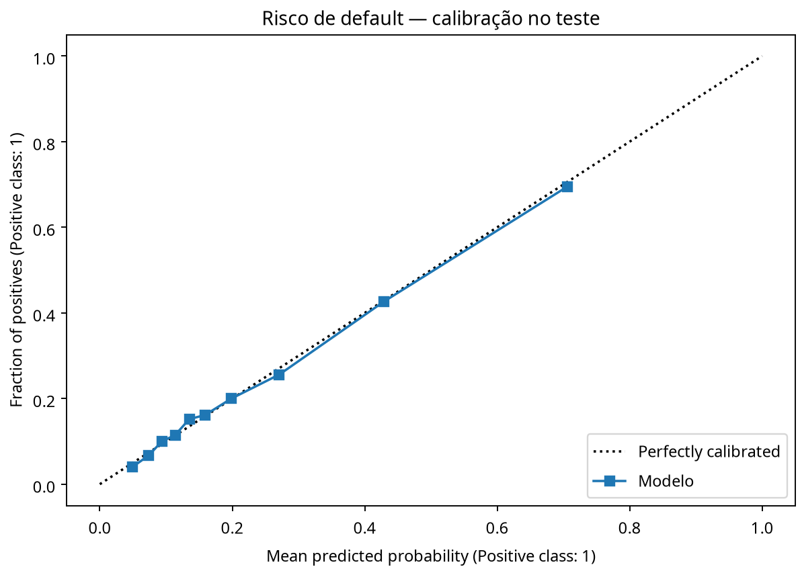

# 08 — Modelagem de risco de inadimplência para bancos

## Problema de negócio

Estimar o risco de inadimplência para priorizar análise de carteira, comparar poder discriminativo e avaliar se as probabilidades estão calibradas. O resultado é um benchmark analítico, não score regulatório, aprovação automática ou recomendação de crédito.

## Dados

O UCI Default of Credit Card Clients contém 30.000 clientes de cartão em Taiwan. Os dados incluem limite de crédito, histórico de pagamentos, valores de faturas e pagamentos entre abril e setembro de 2005; o alvo `Y` indica default no mês seguinte. `X2` (sexo) é removida dos preditores e usada apenas para uma auditoria descritiva por grupo. A presença de `X2` como atributo de auditoria não torna o modelo justo ou conforme.

## Desenho analítico

O pipeline usa partições estratificadas de treino, validação e teste (50/25/25). Regressão logística e HistGradientBoosting são comparados pela Average Precision na validação. O teste é medido uma vez depois da seleção. O pré-processamento categórico e numérico fica dentro de `Pipeline`/`ColumnTransformer`. Métricas incluem Average Precision, ROC-AUC secundária, Brier score, log loss e captura de inadimplentes em diferentes capacidades de revisão. A auditoria por sexo apresenta taxas de default, recall e falsos positivos no limiar descritivo 0,5; não é uma avaliação legal de fairness.

A base não contém LGD, recuperações, custos de cobrança ou custo de capital. Por isso, o projeto não calcula perda esperada nem ROI. O limiar 0,5 não é uma regra de concessão.

## Resultado no split executado

No teste estratificado de 7.500 registros, HistGradientBoosting obteve **Average Precision de 0,556**, ROC-AUC de 0,779 e Brier score de 0,135. Nos 5% de maior score, 292 dos 375 clientes tinham default no teste (precisão de 77,9%; captura de 17,6% dos defaults). A auditoria descritiva por `X2` mostra diferenças de recall no limiar 0,5; isso deve motivar investigação, mas não prova fairness nem justifica uma decisão de política.





## Executar

Requer Python 3.10 ou superior e conexão à internet na primeira execução:

```bash
python -m venv .venv
source .venv/bin/activate       # Windows: .venv\\Scripts\\activate
pip install -r requirements.txt
python default_risk_pipeline.py --output-dir artifacts
python -m unittest -v test_default_risk.py
```

O script usa `ucimlrepo` para carregar a fonte UCI. Gera `metrics.json`, `precision_recall_test.png`, `calibration_test.png` e salva localmente `default_risk_model.joblib`. Dados e modelo não são incluídos no Git.

## Limitações

Os dados são históricos e representam um portfólio de Taiwan, não clientes atuais ou outras jurisdições. O teste retrospectivo não representa produção. A auditoria de um único campo não captura todos os riscos de proxy, viés, governança ou contexto legal.

## Fonte

- UCI, [Default of Credit Card Clients](https://archive.ics.uci.edu/dataset/350/default+of+credit+card+clients). O repositório informa 30.000 instâncias e licença CC BY 4.0.
