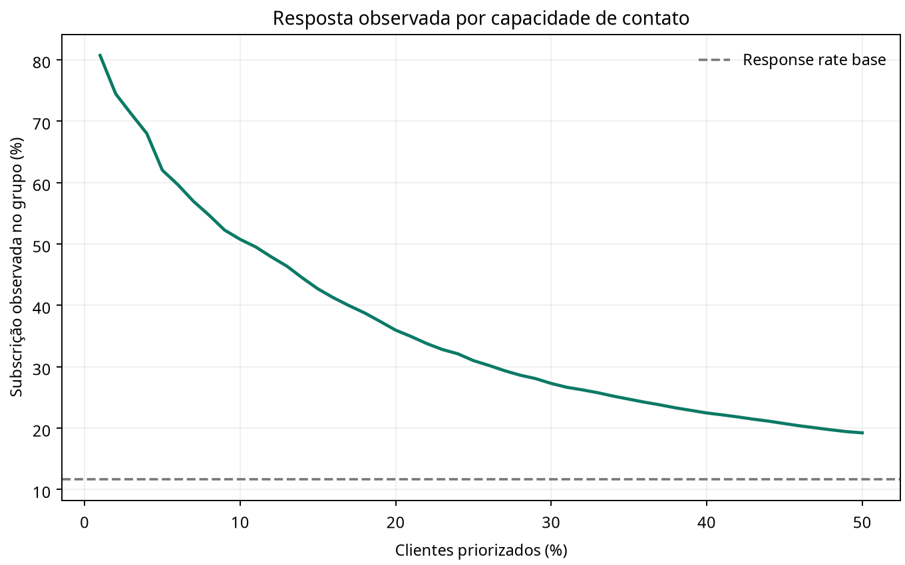
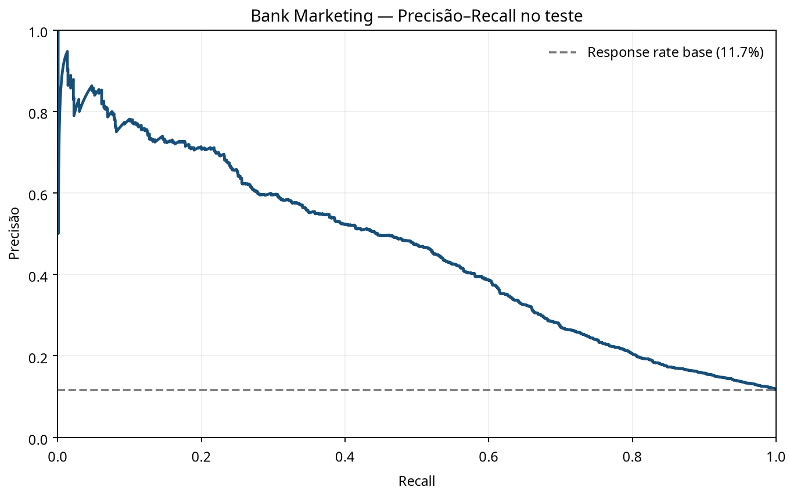

# 09 — Priorização analítica de campanhas bancárias

## Problema de negócio

Estimar propensão observacional à subscrição de um depósito a prazo para apoiar a priorização de contatos quando a capacidade do canal é limitada. O projeto não estima efeito incremental da campanha: a base não é um experimento randomizado e não contém os resultados contrafactuais necessários para afirmar uplift ou causalidade.

## Dados e controle de vazamento

Usa o UCI Bank Marketing, com 45.211 registros e dados de campanha telefônica de uma instituição portuguesa. O alvo `y` indica se o cliente subscreveu um depósito a prazo. `duration` é removida por ser conhecida somente após a chamada; `campaign` também é excluída por incluir o contato atual, não estando garantidamente disponível no momento da priorização.

## Modelagem

Compara regressão logística e HistGradientBoosting, mantendo o pré-processamento dentro do pipeline. A divisão estratificada é 50/25/25 para treino, validação e teste; o modelo é selecionado por Average Precision na validação. No teste, reporta Average Precision, ROC-AUC secundária, Brier score e taxa de resposta observada entre os clientes priorizados para diferentes capacidades de contato.

A taxa de resposta de um grupo priorizado é descritiva, não o número de respostas incrementais causadas pela abordagem. Como a fonte não inclui custos de contato nem valor financeiro, o projeto não estima ROI.

## Resultado no split executado

No teste estratificado de 11.303 clientes, HistGradientBoosting obteve **Average Precision de 0,458**, ROC-AUC de 0,795 e Brier score de 0,081; a resposta observada no teste foi 11,7%. Nos 1% de maior score (114 contatos), 92 clientes subscreveram (taxa observada de 80,7%), representando 7,0% de todas as subscrições do teste. Esse ganho de concentração é descritivo e não deve ser apresentado como uplift ou efeito provocado pelo modelo.





## Executar

Requer Python 3.10 ou superior e internet na primeira execução:

```bash
python -m venv .venv
source .venv/bin/activate       # Windows: .venv\\Scripts\\activate
pip install -r requirements.txt
python campaign_response_pipeline.py --output-dir artifacts
python -m unittest -v test_campaign_response.py
```

Produz `metrics.json`, `precision_recall_test.png` e `response_by_capacity.png`. O modelo salvo localmente e os dados brutos são excluídos do Git.

## Limitações

Os dados são históricos e se referem a uma campanha de um banco português, não às práticas atuais de outros bancos. O score não mede efeito causal, não recomenda tratamento diferenciado sem validação e não substitui políticas de consentimento, adequação ou governança.

## Fonte

- UCI, [Bank Marketing](https://archive.ics.uci.edu/dataset/222/bank+marketing). O repositório descreve campanhas telefônicas de instituição portuguesa e informa licença CC BY 4.0.
