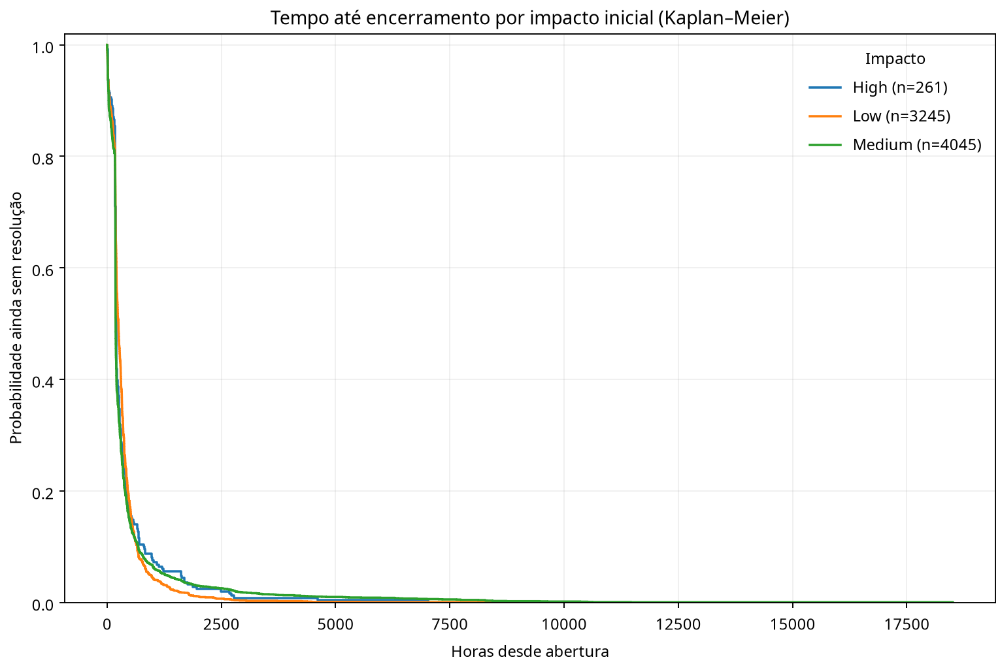
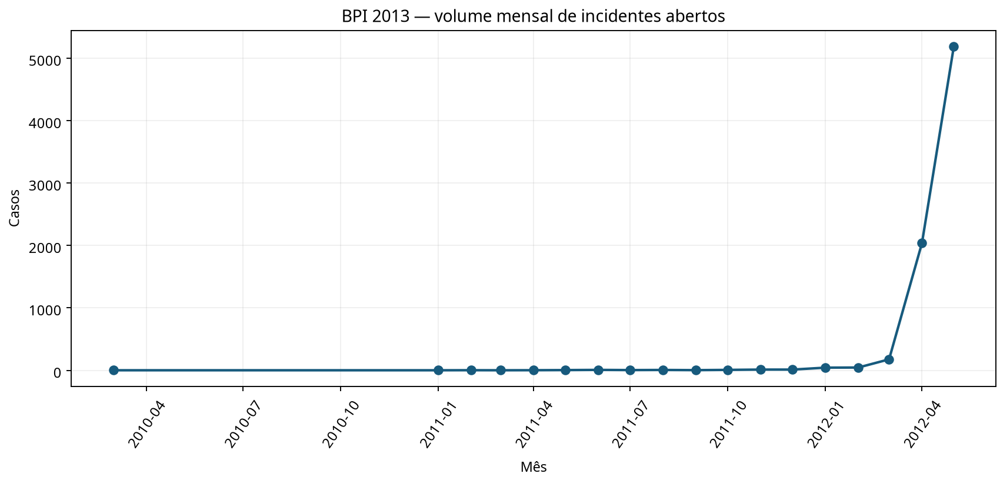

# 10 — Analytics de operações de TI empresarial (ITSM)

## Problema de negócio

Analisar fluxo de incidentes e apoiar a triagem de tickets em operações de service desk. O projeto cobre gestão de incidentes e processo de atendimento de TI; **não é um projeto de segurança cibernética**.

## Dataset

Usa o log de eventos BPI Challenge 2013, originado do sistema de gestão de incidentes da Volvo IT Belgium. A fonte oficial fornece eventos XES com atividades, timestamps, estado do ciclo de vida, impacto, produto e grupos organizacionais. O projeto não inclui o arquivo de dados no repositório; o script baixa o log da fonte do desafio quando executado. Nomes individuais de recursos são excluídos das features e dos resultados agregados publicados.

## Análises e modelagem

O parser XES cria KPIs de fluxo por caso: span observado, número de eventos, mudanças de grupo, diversidade de grupos e proxy de tempo em estados de espera. A análise de tempo até resolução usa Kaplan–Meier: casos cujo último estado é `Closed` ou `Resolved` contam como evento observado; os demais são censurados à direita no último timestamp. Calcula probabilidades sem resolução em horizontes operacionais, tempo médio restrito e curvas descritivas por impacto. Também produz métricas de handoff e volume ao longo do tempo.

O resultado é uma análise histórica do tempo até encerramento, **não previsão de SLA**. A proxy de espera é construída a partir dos intervalos entre eventos no log e precisa ser validada com a semântica do sistema de origem. O método assume censura não informativa, hipótese que pode falhar quando os casos continuam abertos por razões operacionais; a limitação é registrada nos resultados.

## Resultado e decisão metodológica

O log contém 7.554 casos e 65.533 eventos; 5.663 casos (75,0%) terminam em `Closed` ou `Resolved` e 1.891 são censurados no último evento. A mediana Kaplan–Meier estimada até encerramento é **200,2 horas** (cerca de 8,3 dias). A curva estima que 87,7% ainda não tinham encerrado até 72 horas. São estatísticas descritivas deste log, não metas de atendimento.

Um diagnóstico temporal encontrou forte mudança de distribuição: no treino, o p75 de resolução foi 471,8 horas; na janela posterior, **0 de 938 casos encerrados** excedeu esse limiar. Por isso, não publiquei um classificador de “tickets longos” com um holdout sem exemplos positivos; o projeto reporta análise de sobrevivência e explicita o problema de estabilidade em vez de embaralhar o tempo.

A categoria de impacto `Major` tem somente três casos e não é apresentada como comparação interpretável; a curva inclui apenas grupos com pelo menos 25 incidentes.





## Executar

Requer Python 3.10 ou superior e internet para baixar o log oficial:

```bash
python -m venv .venv
source .venv/bin/activate       # Windows: .venv\\Scripts\\activate
pip install -r requirements.txt
python itsm_pipeline.py --output-dir artifacts
python -m unittest -v test_itsm_pipeline.py
```

Por padrão, o XES é salvo em `data/` (ignorado pelo Git). É possível indicar uma cópia local com `--xes caminho/arquivo.xes.gz`. São produzidos `metrics.json`, `monthly_incident_volume.png` e `survival_by_impact.png`. O arquivo XES não é versionado.

## Limitações e privacidade

O log é histórico (2010–2012), de uma organização e processo específicos, com muitos casos ainda abertos no corte dos dados. Isso cria censura à direita e pode alterar a composição das partições temporais. A fonte não define SLA, custo por ticket, satisfação ou impacto comercial. Não se deve interpretar a duração como violação contratual. Agregados não exportam nomes de pessoas; o arquivo original permanece fora do repositório. Respeite os termos de uso da fonte ao baixar e reutilizar os dados.

## Fontes

- [Página oficial do BPI Challenge 2013](https://ais.win.tue.nl/bpi/2013/challenge.html), que descreve o log real da Volvo IT e disponibiliza o XES.
- [Registro institucional 4TU.ResearchData](https://data.4tu.nl/articles/dataset/BPI_Challenge_2013_incidents/12693914), DOI [10.4121/uuid:500573e6-accc-4b0c-9576-aa5468b10cee](https://doi.org/10.4121/uuid:500573e6-accc-4b0c-9576-aa5468b10cee), com termos gerais de uso do repositório.
